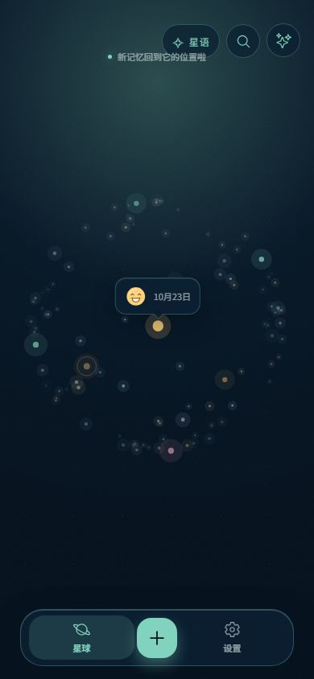
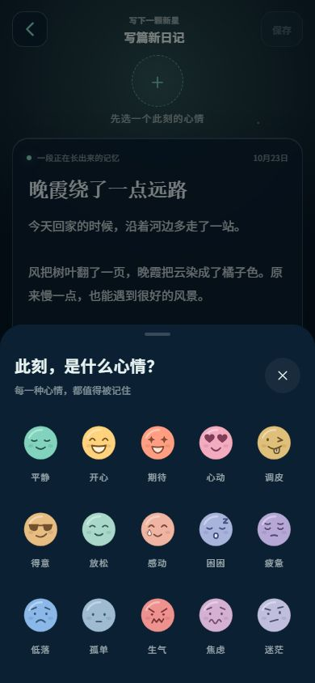
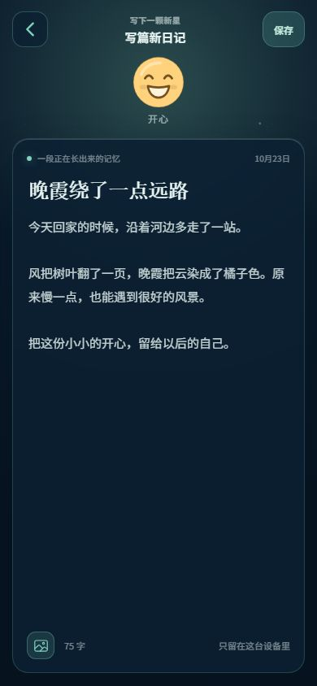
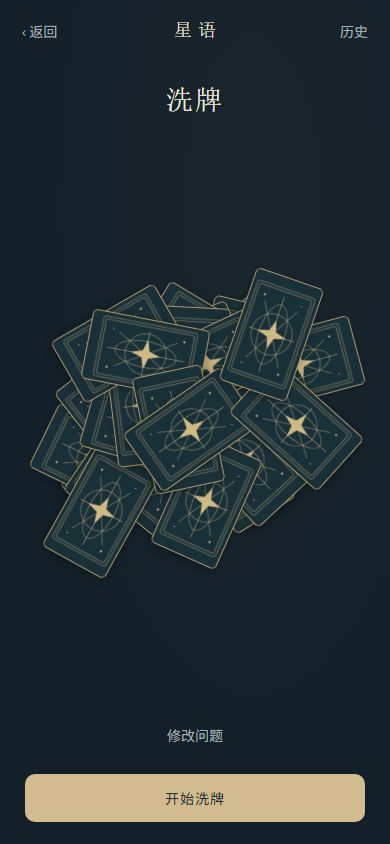

  

<h1 align="center">拾光笺</h1>

<strong>把日子，过成自己的星空。</strong>

本地优先的私人日记 · 十五种心情表情 · 记忆星球 · 星语塔罗

  <a href="https://github.com/boringHub/shiguangjian/releases/latest">下载 Android 版</a> ·
  <a href="#页面一瞥">页面一瞥</a> ·
  <a href="CHANGELOG.md">更新日志</a> ·
  <a href="docs/DEVELOPMENT.md">参与开发</a>

一顿好吃的饭，一阵刚好的风，或是今天说不清的心情，都可以留在这里。

**拾光笺**想把写日记变成一件轻松的小事：先为此刻选一个表情，再写几句话、放几张照片。每篇日记都会成为记忆星球上的一束光，转一转，就能和过去的自己打个照面。想停下来梳理思绪时，也可以进入**星语塔罗**，给心里的问题留一点空间。

## 页面一瞥

<table>
  <tr><th>记忆星球</th><th>心情表情</th><th>日记编写</th><th>星语塔罗</th></tr>
  <tr>
    <td></td>
    <td></td>
    <td></td>
    <td></td>
  </tr>
</table>

以上为 2026 年 10 月开发版 Web 界面的实际截图，文字均为虚构展示样例。包含尚未发布的心情与塔罗功能，下载版请以 [Release 说明](https://github.com/boringHub/shiguangjian/releases/latest) 为准。

## 在这里，慢慢收藏自己

### 让日常有自己的引力

日记不只按列表排列，也化成一颗可以转动的记忆星球。拖动、缩放，按日期寻找，或随机回望一段记忆；不同心情有不同的星光颜色，收藏的瞬间也可以再被找到。

### 先接住心情，再写下今天

平静、开心、期待、心动、调皮、得意、放松、感动、困困、疲惫、低落、孤单、生气、焦虑、迷茫——十五种彩色简笔表情，给情绪多一点表达。

点击编写框上方的虚线圆圈，唤出表情面板；选好后，小表情就会留在日记上方。文字和最多五张照片一起收好今天，详情和星球气泡也会保留这份心情。不规定字数，几句话也是一篇日记。

### 星语塔罗，换一个角度倾听自己

从购物决策、二选一、近期状态、关系相处、工作学业和一张指引中，选一个想聊的方向。写下问题，亲手洗牌、切牌、选牌，再翻开属于这次提问的牌组。

- 78 张随包卡面与正逆位参考牌义，完整基础流程可离线使用。
- 问题草稿、历史、收藏与个人笔记留在本机，方便日后回看。
- AI 解读默认关闭，服务端尚待接入；当前提供的是离线体验。

塔罗提供思考角度，选择仍由你决定。更多画面见 [塔罗首页](docs/screenshots/tarot-home.jpg)；实现状态见 [星语塔罗说明](docs/tarot/IMPLEMENTATION.md)。

### 给小宇宙换一件外衣

记忆星空、晨雾纸笺、晚风邮局，三套内置主题陪伴不同的日常。全局界面与 Android 系统栏随主题变化，也支持导入 ZIP 界面主题包。

## 你的记录，先留在你身边

新建、查看、编辑和删除日记都在本机完成，无需账号，也不依赖网络或邮件服务。Android 使用 SQLite 和应用私有图片目录；浏览器预览的数据独立保存在当前浏览器中，两端不会自动同步。

未主动分享的日记保留在本机。只有明确选择分享单篇日记时，标题和纯文本正文才发送给所配置的邮件服务，图片不随邮件发送。

目前**没有自动云端备份**。卸载 App、清除应用数据或丢失设备可能导致记录丢失；更新时请使用同一正式渠道直接覆盖安装，保留已有日记。

## 下载与体验

目前提供 **Android 开发预览版**，iOS 暂未提供。

- [查看最新正式 Release](https://github.com/boringHub/shiguangjian/releases/latest)
- [直接下载 Android APK](https://github.com/boringHub/shiguangjian/releases/latest/download/shiguangjian-android.apk)
- [备用下载 ZIP（解压后安装 APK）](https://diary-app.oss-cn-hangzhou.aliyuncs.com/releases/latest/shiguangjian-android.zip)

安装时可按 Android 提示允许对应浏览器或文件管理器安装应用。已有用户也可以在“设置 → 应用更新”中检查新版本。当前开发分支与已发布安装包可能不同，尚未发布的改动见 [更新日志](CHANGELOG.md)。

官网源码位于 [website](website/README.md)，提供记忆星球互动、心情选择、主题预览与实际 App 画面，可独立部署为静态网站。

## 一起让它慢慢长大

接下来希望完善数据导出、导入与备份，增加每篇日记的个性化日记板，并完成星语塔罗在线解读的接入与验收。欢迎通过 [Issues](https://github.com/boringHub/shiguangjian/issues) 分享建议，或提交改进。请不要在公开讨论中附上私人日记与凭据。

### 可选的邮件通知接入

邮件是可继续扩展的方向，纯本地日记无需配置服务端。公开仓库保留了兼容接口与客户端流程，**不包含当前托管的通知服务端**；其他开发者可以自行实现或部署对应服务。

可参考 Cloudflare Workers、D1、Queues / DLQ 与 Resend，扩展邮箱验证、可选提醒、单篇日记分享和投递状态。接入时仍应保证日记先在本机保存，离线或邮件失败不影响写日记；使用者通知邮箱与分享收件邮箱保持独立。

不接入时保持 `VITE_NOTIFY_API_ORIGIN` 为空即可。详细配置、数据边界与反馈接口见 [开发指南：可选的邮件通知接入](docs/DEVELOPMENT.md#可选的邮件通知接入)。

### 给开发者的入口

App 使用 Ionic Vue、TypeScript、Pinia、Capacitor 与 SQLite，星球通过 Canvas 绘制；官网为独立 Astro 静态工程。

- [开发指南](docs/DEVELOPMENT.md)：本地启动、存储、主题包、邮件接入与 Android 构建。
- [App 开发设计](App端开发设计文档.md) · [星语塔罗设计](docs/tarot/README.md) · [官网开发与部署](website/README.md)。
- [发布手册](RELEASE.md) · [正式与测试渠道](docs/RELEASE_CHANNELS.md) · [更新日志](CHANGELOG.md)。

## 开源许可

原创代码、文档和官网源码采用 [Apache License 2.0](LICENSE)，允许遵守许可证的使用、修改、商用与分发。项目名称与 Logo 不因此授予商标使用权。

版权与归属见 [NOTICE](NOTICE)，依赖、字体及塔罗卡面的来源与授权见 [THIRD_PARTY_NOTICES.md](THIRD_PARTY_NOTICES.md)。第三方内容沿用各自许可证。

愿你回头看时，有迹可循，有光可拾。✦

